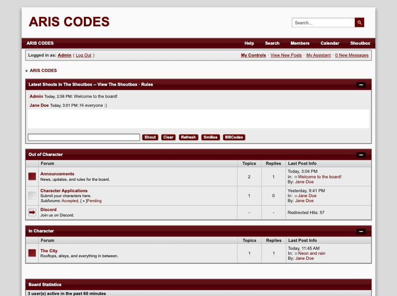

# Jcink Base Skin

Clone, build, and test Jcink forum skins **on your own computer**. You can see every change instantly, without touching your live forum. When you're happy, export the XML or copy the finished code and send it to your Jcink Admin CP with a few clicks.

The project starts out looking exactly like Jcink's default skin. Everything you write here uses the same code as Jcink, including board wrappers (`<% BOARD %>`), template variables (`<!-- |name| -->`), and macros (`<{A_REPLY}>`). 



> ### This project has used AI to generate parts of its code.
>
> I know many people in the Jcink coding community are against the use of AI in their projects, and I completely understand why. I want to be upfront about the use of it in this project, so you can decide for yourself whether to use this project.
>
> My workplace pays for an AI coding tool and enforces the use of it, with a minimum threshold being required. Since that money is already spent, I've chosen to put as much of it as I can toward personal projects like this one, which I'm sharing for free.
>
> - 🤖 The code and guides were written with an AI assistant (Claude). The code has then been thoroughly tested and reviewed manually, by me. I've been a QA since 2021 and I hold a strict quality standard. Every bug fix is checked and retested by me before it's released.
> - 📋 The default stylesheet, wrapper, macros, and templates are **Jcink's own defaults**, not AI-generated. They can be found [here](https://jcink.com/wiki/jfh-skinning-default-templates).
> - 💭 The documentation was drafted with AI, then edited and reviewed by me, a human being. I will do my best to make this project as accessible as possible, to ensure people can code more easily and then ship their skins to Jcink seamlessly.
> - ✍️ **No AI is used when you run the project.** It works entirely on your computer, doesn't connect to any AI service, and nothing you write here is sent anywhere. Your code will not be scraped, fed into an algorithm, or used to further build LLMs against your will.
>
> If you, at any point, feel uncomfortable using this project because it uses AI, I recommend you stop using it. 😊 Maintaining your values and moral standard is extremely important for humans and humanity as a whole, and I believe that there is nothing more important than standing by what you believe in.
> 
> In my personal life, I do not support the use of generative AI. Even more so, I do not believe it should be used to support coding for Jcink. This hobby for me has always been about creating and learning, an online DIY community that I have enjoyed partaking in for most of my life.
>
> At the moment, for me, using my company's resources in this manner is my _personal_ act of rebellion.

---

## Contents

1. [What is this project?](#1-what-is-this-project)
2. [What do you need?](#2-what-do-you-need)
3. [How do I install this?](#3-how-do-i-install-this)
4. [Your first edit](#4-your-first-edit)
5. [What every folder and file is for](#5-what-every-folder-and-file-is-for)
6. [Custom profile fields](#6-custom-profile-fields)
7. [Changing the sample forum content](#7-changing-the-sample-forum-content)
8. [Putting your skin on Jcink](#8-putting-your-skin-on-jcink)
9. [Which Jcink pages are covered](#9-which-jcink-pages-are-covered)
10. [Troubleshooting](#10-troubleshooting)
11. [Glossary](#11-glossary)

---

## 1. What is this project?
This project started out of a personal frustration: whenever I started working on a Jcink skin, I would have to create a new skin set, paste in all of my "defaults" (variables, scripts, and so on), and then begin editing in the ACP, save, switch tab, refresh, rinse-and-repeat. On top of this, a browser's cookies or delays between the server sometimes would require multiple refreshes.

This project allows you to **clone a default Jcink forum** to your computer and make changes quicker and simpler. You can work locally, create data samples in JSON files that don't require you to have registered members (for new sites), is compatible with major Jcink features (macros, custom profile fields, etc.), and can be quickly exported to add to your site.

Here is a more detailed breakdown of the currently supported features, as of November 2026:

- 🔁 **Update as you save.** Make any change, save the file, and the page in your browser changes immediately. No server lag, no cookies, no restarts, no _frustration_.
- 🧩 **Jcink compatible.** Your wrapper, stylesheet, macros and HTML templates work exactly like they do on Jcink, including variables like `<!-- |name| -->`.
- 🗂️ **Sample content.** The project provides categories, forums, topics, posts, and members by default. You can always edit them in `data/`, and information on how to edit and add more is provided in `documentation/`.
- 🏷️ **Profile-field support.** You can export your site's custom profile fields from the Admin CP and paste them straight into `data/custom-fields.json`. Alternatively, you can create them using the provided pattern and import them straight into the Admin CP.
- 📋 **Export to Jcink.** The "Copy to Jcink" (`localhost:3000/__copy`) page gives you a Copy button for every box in the Admin CP, plus importable skin files.
- 🐛 **Easier troubleshooting.** Because you will work with an IDE, mistakes are not only minimised by the program itself, but troubleshooting through errors is inherently easier. For experienced developers who work with JavaScript, swapping this project's `dev/` core into TypeScript should not take a long time.

---

## 2. What do you need?

In short, this project is _entirely_ free. The resources you need you already have (a computer, no matter how low-end) and a couple of free programs to support your work.

> 💭 If you are concerned about running a server on an old laptop, don't be! This project runs a preview website on your computer, which does not require a lot of computing power, it's about 50 MB of your memory. 

| What | Why                                                                                       | Cost |
|---|-------------------------------------------------------------------------------------------|---|
| A computer (Mac, Windows or Linux) | To run the server                                                                         | – |
| **Node.js** version 20 or newer | It runs the preview                                                                       | Free |
| A **code editor** | To edit the files. [Visual Studio Code](https://code.visualstudio.com/) is a popular choice. | Free |
| A web browser | To look at the preview                                                                    | Free |

For the installation of this project, you **do not** need to know any advanced coding. You only type two short commands in your terminal. This guide shows you exactly what to type, with explanations on what each command does and means.

---

## 3. How do I install this?

### Step 1: Install Node.js

Node.js is a free, open-source, cross-platform JavaScript runtime environment that lets developers create servers, web apps, command line tools. For this project, use Node.js's **pre-built installer**. It's a normal installer you double-click, with no commands to type.

1. Go to **[the download page](https://nodejs.org/en/download)**.
2. Make sure the version at the top is one marked **LTS** ("Long-Term Support", the stable one). It usually is pre-selected already.
3. **Skip the box of commands** at the top of the page. That's for a different install method.
4. Scroll down to **"Or get a prebuilt Node.js®"** and click the installer for your computer:
   - **Mac:** **macOS Installer (`.pkg`)**
   - **Windows:** **Windows Installer (`.msi`)**
5. Open the downloaded `.pkg` or `.msi` file and click through the installer, keeping all the default options. It installs **npm** too, which this project also needs.

> ✅ The page normally detects your computer automatically. If it picks the wrong system, change it in the dropdowns next to "Or get a prebuilt Node.js® for…".

> 💡Node Package Manager (`npm`) is the default package manager for Node.js and the world's largest software registry for JavaScript. It lets developers share, install, and manage reusable code packages or libraries in their projects

**To check it worked**, open a terminal (see the box below) and type the line below, then press **Enter**. You should see a version number like `v24.22.2`. If the first number is **20 or higher**, you're set.

```bash
node -v
```

> 💡 Boxes like the one above (marked `bash`) are commands you type into your terminal. Bash is the terminal program on Mac and Linux. On Windows you'll use PowerShell instead, but these commands are typed exactly the same way.

> #### 💡 How do I open a terminal?
> A terminal is a window where you type commands instead of clicking.
> - **Mac:** press `Cmd + Space`, type **Terminal**, press Enter.
> - **Windows:** press the Windows key, type **PowerShell**, press Enter.
> - **In VS Code:** use the menu **Terminal → New Terminal**. This is the easiest option, because it opens in the right folder automatically.

### Step 2: Download this project

**Option A, no tools needed:**

1. On this project's GitHub page, click the green **Code** button.
2. Click **Download ZIP**.
3. Unzip it somewhere easy to find, like your Documents folder.

**Option B, if you use Git:**

```bash
git clone https://github.com/baebushka/jcink-base-skin.git
```

### Step 3: Open the project folder in your code editor

In VS Code, choose **File → Open Folder…** and pick the project folder (the one containing `README.md`). Then open a terminal inside it: **Terminal → New Terminal**.

> If you use a separate terminal window instead, move into the project folder first. Type `cd` and a space, drag the folder onto the terminal window, then press Enter.

### Step 4: Start the preview

In the code editor (or IDE) terminal, type:

```bash
npm run dev
```

You should see:

```
Jcink preview: http://localhost:3000
Copy to Jcink: http://localhost:3000/__copy
```

`http://localhost:3000` is your copy of the Jcink site. 

`http://localhost:3000/__copy` is where you can see all your codes and export them (instead of navigating between pages).

### Step 5: Open it in your browser

Go to **http://localhost:3000**. You'll see a forum in Jcink's default style. 🎉

A small dark toolbar in the bottom-right corner lets you jump between pages and open the **Copy code** page.

> **Leave the terminal open in your IDE** while you work. That's the preview running. To stop it, click into the terminal and press `Ctrl + C`. To start it again later, repeat Step 4.

There's nothing else to install. This project doesn't download any extra packages.

---

## 4. Your first edit

Let's change the forum's main color to make sure everything works.

1. With the preview running, open **`skin/stylesheet.css`** in your editor.
2. Find this block (around line 421; `Cmd + F` / `Ctrl + F` and search for `.maintitle {`):
   ```css
   .maintitle {
   	background-color: #800000;
   ```
3. Change `#800000` to `#2b6cb0`.
4. Save the file (`Cmd + S` on Mac, `Ctrl + S` on Windows).
5. Look at your browser. The category title bars are now blue, and you didn't refresh. ✨

Every file in the `skin` folder works this way.

---

## 5. What every folder and file is for

```
jcink-base-skin/
├── skin/          ← YOUR SKIN. This is what goes into Jcink.
├── data/          ← Sample forum content and custom fields. Stays on your computer.
├── dev/           ← The engine that runs the preview. You usually don't touch this.
├── dist/          ← Created by "npm run build": importable skin files.
├── docs/          ← Pictures used in this guide.
├── documentation/ ← Step-by-step guides (for example, adding forums and posts).
├── package.json   ← Tells Node.js which commands exist (dev, build, copy).
├── .gitignore     ← Tells Git which files not to upload.
├── LICENSE        ← The MIT license: what others may do with this project.
├── changelog.md   ← A list of what changed in each version.
└── README.md      ← This guide.
```

### 🎨 `skin/`: your skin (this goes into Jcink)

Each file here matches **one box in your Jcink Admin CP**, under *Skins & Templates*. Edit these files, then copy them into those boxes.

| File | What it is | Where it goes in Jcink |
|---|---|---|
| `wrapper.html` | The **board wrapper**: the page layout around everything (logo, search bar, where the forum content sits). Uses tags like `<% BOARD %>` and `<% NAVIGATION %>`. | Board Wrappers |
| `stylesheet.css` | The **stylesheet** (CSS): all colors, fonts, sizes and spacing. | Style Sheets |
| `macros.json` | Your **macros**: little replacements Jcink swaps in, like buttons and icons. `<{A_REPLY}>` in your code becomes the "Add Reply" button. Starts as Jcink's default macro set. | Macros |
| `skin.json` | Your skin's **name**, used for the downloadable skin file. | – (just a setting) |
| `templates/` | Your **HTML templates**: one file per template (see below). | HTML Templates |
| `images/` | A place for your own images while developing. They show at `/images/your-file.png` in the preview. Before going live, upload them somewhere public and use that link instead. | – |

> 💡**How to read `macros.json`:** each line is `"NAME": "what it turns into"`. For example:
> 
> ```json
> "A_REPLY": "<div class='button-large'>Add Reply</div>",
> ```
> 
> means "wherever `<{A_REPLY}>` appears, show an Add Reply button." Keep the quotes and the comma at the end of each line, except the last one.

#### 🧩 `skin/templates/`: one file per HTML template

| File | Jcink template name | What it controls |
|---|---|---|
| `cat_head.html` | Category List Header | The box around each category on the index (title bar and column headings). `<% FORUM_ROWS %>` is where the forums go. |
| `forum_row.html` | Forum Row | One forum in a category: its icon, name, description, counts and last post. |
| `redirect_row.html` | Redirect Row | A forum that links to another website. |
| `subf_head.html` | Subforum List Header | The box listing subforums at the top of a forum. |
| `topic_list_head.html` | Topic List Header | The box around a forum's topic list. `<% TOPIC_ROWS %>` is where topics go. |
| `topic_row.html` | Topic Row | One topic in a forum: title, starter, replies, views and last post. |
| `post_row.html` | Post Row | One post in a topic: the author, date, buttons and the post itself. |
| `mini_profile.html` | Mini Profile | The member info beside each post: avatar, group, post count and custom fields. |
| `board_stats.html` | Board Statistics | The "who's online" and statistics box at the bottom of the index. |
| `profile.html` | Main Profile | A member's full profile page. *(Jcink doesn't publish a default for this one, so this is a starter you can change freely.)* |
| `member_list_head.html` | Member List Header | The box around the member list. |
| `member_list_row.html` | Member List Row | One member in the member list. |

Inside templates you'll see **variables** like `<!-- |posts| -->`. Jcink replaces these with real information, such as the member's post count. The [Jcink HTML Templates Documentation](https://jcink.com/wiki/jfh-html-templates) lists every variable each template can use, and they all work here too.

> **Tip:** If you add a variable or macro the preview doesn't know, a **⚠ number** appears in the bottom-right toolbar. Click it to see what's missing.

### 🗂️ `data/`: sample content (stays on your computer)

This is the **pretend forum** the preview shows. None of it goes to Jcink. Change it to whatever helps you design. For example, add a long topic to test your post layout, or a member with no avatar.

| File | What's in it |
|---|---|
| `custom-fields.json` | Your board's **custom profile fields** (see [section 6](#6-custom-profile-fields)). |
| `members.json` | The sample **members**: names, groups, avatars, post counts and their custom field answers. |
| `forums.json` | The **categories**, **forums**, **subforums**, **topics** and **posts**. |
| `board.json` | General **board info**: the board name, which member you're "logged in" as, member **groups** (with name colors), the statistics numbers and sample **shoutbox** messages. |
| `images/` | Sample avatars used by the sample members. |

### ⚙️ `dev/`: the preview engine (you usually don't need to open this)

| File | What it does |
|---|---|
| `server.js` | Runs the preview website at `localhost:3000`, watches your files and refreshes the browser when you save. Also creates the **Copy to Jcink** page. |
| `render.js` | Builds each page the way Jcink does: takes the sample data, fills in your templates, places the result in your wrapper, then swaps in your macros. |
| `skin.js` | Reads all the files in `skin/` and `data/`, and holds the list of template files. |
| `pieces.js` | Lists everything you paste into Jcink, and builds the importable XML skin files. |
| `build.js` | Runs when you type `npm run build`. Saves the XML files into `dist/`. |
| `copy.js` | Runs when you type `npm run copy`. Copies one piece of your skin to the clipboard. |
| `jcink/board-header.html` | What Jcink outputs for `<% BOARD HEADER %>` (the menu bar and "Logged in as" bar). Copied from a real Jcink board. |
| `jcink/shoutbox.html` | What Jcink outputs for `<% DSHOUTBOX %>` (the shoutbox). |
| `jcink/copyright.html` | What Jcink outputs for `<% COPYRIGHT %>` (the footer). |
| `jcink/fallback-macros.json` | Values Jcink uses for macros that a macro set doesn't include (for example the "Important Topics" heading). To change one, add the same name to `skin/macros.json` instead. |

> If you edit anything in `dev/` other than the `jcink` folder, stop the preview (`Ctrl + C`) and start it again (`npm run dev`) for the change to take effect.

---

## 6. Custom profile fields

Jcink lets members fill in extra profile fields, such as a face claim or an age. Each field has a number, and templates show it with a **template variable** like `<!-- |field_76| -->`.

This project reads your fields in **the same format Jcink exports them**, so you can paste your board's export straight in. Your sample members' answers then appear everywhere you use those variables, so you never type sample data into your templates.

### Step 1: Put your fields in `data/custom-fields.json`

**Easiest:** export your custom profile fields from your Jcink Admin CP and paste the whole export into `data/custom-fields.json`, replacing the examples.

**Or add a field by hand.** Each field looks like this:

```json
"76": {
  "fid": "76",
  "ftitle": "languages spoken",
  "fdesc": "one per line",
  "fcontent": "",
  "ftype": "area",
  "freq": "0",
  "fhide": "0",
  "fmaxinput": "0",
  "fedit": "1",
  "forder": "65",
  "fshowreg": "0",
  "fjsonversion": "1.00"
}
```

To add another, copy a whole block, put a comma between blocks, and change the number in **both** places (eg. `"76":` and `"fid"`).

**What each setting means.** The first column matches the column names in your Admin CP's custom fields list:

| Admin CP column | Setting | Values |
|---|---|---|
| Field Title | `ftitle` | The field's name. `fdesc` is its description. |
| Type | `ftype` | `"text"` (one line), `"area"` (several lines; line breaks become `<br />`) or `"drop"` (a dropdown). |
| Template Variable | `fid` | `"76"` means you write `<!-- \|field_76\| -->` in your templates. |
| Required | `freq` | `"1"` = yes, `"0"` = no. The preview warns you if a sample member leaves a required field empty. |
| Hidden | `fhide` | `"1"` = yes, `"0"` = no. |
| Show on Reg. | `fshowreg` | `"1"` = shown on the registration form. |
| Member Editable | `fedit` | `"1"` = members can change it themselves. |
| – | `fmaxinput` | Maximum length (`"0"` = no limit). The preview warns you if a sample answer is too long. |
| – | `forder` | The field's position in the list. |
| – | `fcontent` | For dropdowns: the choices, written as `key=Label\|key=Label`, for example `no=no\|yes=yes`. Jcink's export sometimes includes a stray `\r` after an option (`"no=no\r\|yes=yes"`). That's normal, and the preview ignores it. |

The preview only uses the settings that change what a page looks like. Hidden, Show on Reg. and Member Editable are kept so the file stays identical to Jcink's export.

### Step 2: Give your sample members answers in `data/members.json`

Inside each member there's a `"fields"` section. Use the same name as the template variable:

```json
"fields": {
  "field_1": "Zendaya",
  "field_4": "she",
  "field_76": "English\nSpanish"
}
```

- For **dropdowns**, use either the key (`she`) or the label (`she/her`). The page shows the label.
- For **multi-line** (`area`) fields, start each new line with `\n`.
- A member who leaves a field out shows nothing there, just like on Jcink.

### Step 3: Use the field in your templates

Put `<!-- |field_76| -->` anywhere in `mini_profile.html`, `post_row.html`, `profile.html`, `member_list_row.html` or the wrapper:

```html
<div class="postbit">Languages: <!-- |field_76| --></div>
```

Save, and every post in the preview shows each member's answer.

> The **⚠** in the bottom-right toolbar lists custom field problems: a required field left empty, an answer that's too long, a dropdown answer that isn't one of the choices, or a template using a field that isn't in `custom-fields.json`.

> ⚠️ **On Jcink itself**, you also have to switch on *"Enable use of Custom Profile Field variables in templates?"* in your Admin CP, or fields won't appear in templates.

## 7. Changing the sample forum content

> 📘 **New to this?** [Adding categories, forums, topics and posts](documentation/adding-forum-content.md) walks through it step by step, with blocks you can copy.

All of these files use a format called **JSON**. A few rules to keep in mind:

- Text goes in **double quotes**: `"name": "Jane Doe"`.
- Numbers don't need quotes: `"posts": 12`.
- Items in a list are separated by **commas**, but there's **no comma after the last one**.
- Lists use `[ ]`, groups of settings use `{ }`.

If you make a mistake, the preview shows a red error message naming the file and position, and nothing breaks for good. Fix the typo, save, and it comes back.

**Examples:**

- **Rename the board:** in `data/board.json`, change `"board_name"`.
- **Preview as a different member:** in `data/board.json`, change `"viewer"` to that member's `id`.
- **Add a member:** in `data/members.json`, copy a whole `{ … }` member block, paste it after the last one (add a comma between them), and give it a new `id`.
- **Add a topic:** in `data/forums.json`, copy a topic block inside a forum's `"topics"` list and change its `id`, title and posts. Each post's `"author"` is a member's `id`.
- **Add a forum that links to another site:** give the forum a `"redirect_url"` (see the "Discord" forum in the sample).
- **Pin a topic:** set `"type": "pinned"`. **Mark one as hot:** add `"hot": true`.

> Topics in a forum should be listed **most recently active first**. The preview uses the first one as the forum's "last post".

---

## 8. Putting your skin on Jcink

There are three ways. Pick whichever is easiest for you.

### Option 1: The Copy page (easiest)

1. With the preview running, click **Copy code** in the toolbar, or go to **http://localhost:3000/__copy**.
2. Each box is labelled with where it goes in your Admin CP, for example *Skins & Templates → HTML Templates → Post Row*.
3. Click **Copy**, open that spot in your Admin CP, select everything in the box, paste, and save.

Macros are listed at the bottom, each with its own Copy button.

### Option 2: Import a skin file

In the terminal (open a second one if the preview is running in the first), type:

```bash
npm run build
```

This creates two files in the `dist/` folder:

| File | What's in it | Where to import it |
|---|---|---|
| `…-skin.xml` | Your **whole skin**: stylesheet, wrapper, macros and HTML templates, in the same layout as Jcink's own skin export. | *Admin CP → Skins & Templates → Manage Skin Sets* → upload box at the bottom |
| `…-templates.xml` | Only your **HTML templates**. | *Admin CP → Skins & Templates → HTML Templates* → upload box |

> The **Main Profile** and **Member List** templates aren't included in Jcink's template files. Copy those two from the Copy page instead.
>
> **Tip:** the first time, import as a new skin set marked *Hide from Members* so you can check it before switching your board over.

### Option 3: Copy from the terminal

```bash
npm run copy -- post_row
```

This puts the Post Row template on your clipboard, ready to paste. Type `npm run copy` on its own to see every name you can use (`wrapper`, `stylesheet`, `mini_profile`).

---

## 9. Which Jcink pages are covered

### Pages the preview builds

Use the toolbar, or type these addresses into your browser. They're the same addresses Jcink uses, so links inside your templates work in the preview too.

| Page | Address | Built from these templates |
|---|---|---|
| **Board index** | `localhost:3000` | Category List Header, Forum Row, Redirect Row, Board Statistics |
| **Single category** | `localhost:3000/index.php?c=1` | Same as the board index |
| **Forum** (its topic list) | `localhost:3000/index.php?showforum=1` | Subforum List Header and Forum Row (when it has subforums), Topic List Header, Topic Row, plus the New Topic / New Poll buttons |
| **Subforum** | `localhost:3000/index.php?showforum=5` | Same as a forum |
| **Topic** | `localhost:3000/index.php?showtopic=1` | Post Row and Mini Profile, plus the Add Reply / New Poll / New Topic buttons* |
| **Profile** | `localhost:3000/index.php?showuser=1` | Main Profile |
| **Member list** | `localhost:3000/index.php?act=Members` | Member List Header, Member List Row |
| **Guest view** of any page above | add `&guest=1` (or `?guest=1` on the index) | Shows "Welcome Guest ( Log In \| Register )" instead of the logged-in links |

Change the number in an address to see a different forum, topic or member.

\* The "Track this topic / Email / Print" bar and the "users reading this topic" strip on topic pages aren't templates. They're a close copy of what Jcink adds itself.

### Parts on every page

| Part | Wrapper tag | Where it comes from |
|---|---|---|
| Logo bar, menu and "Logged in as" bar | `<% BOARD HEADER %>` | Copied from a real Jcink board (`dev/jcink/board-header.html`) |
| Breadcrumbs ("Board → Forum → Topic") | `<% NAVIGATION %>` | Built for each page, using your `F_NAV` and `F_NAV_SEP` macros |
| Shoutbox | `<% DSHOUTBOX %>` | Copied from a real Jcink board, with the sample shouts from `data/board.json` |
| Your forum content | `<% BOARD %>` | The pages in the table above |
| Skin selector | `<% SKIN_SELECTOR %>` | A dropdown with your skin's name |
| Footer | `<% COPYRIGHT %>` | Copied from a real Jcink board (`dev/jcink/copyright.html`) |
| Page title | `<% TITLE %>` | The board name, plus the forum, topic or member name |
| Inline PMs and affiliates | `<% PM %>`, `<% AFFS %>` | Show nothing, like a board without those features turned on |

### Pages the preview doesn't build (yet)

Any other address (anything with a different `?act=`) shows a "This page isn't simulated locally" box. Your wrapper and stylesheet still appear around it. Not covered yet:

- **Posting:** new topic, reply, edit post, polls and fast reply
- **Search:** the search form, results and "View New Posts"
- **User CP** ("My Controls") and all its pages
- **Personal messages:** inbox, reading and writing messages
- **Calendar**
- **Who's online** (the full list)
- **Help, Board Rules and Privacy Policy**
- **Shoutbox** (the full page)
- **Log in and Register**
- **Mod CP** and moderation screens
- **Webpages** made with Jcink's Webpage Maker
- **Store, Awards, Alerts** and the "who posted" pop-up
- **Mobile version**

None of these pages use HTML Templates. Jcink builds them itself, so the only way to preview them is to copy the HTML a real board outputs. That's how the header, shoutbox and footer were added. **Want one added?** Open that page on a Jcink board, choose *View Page Source* in your browser, and share the source in an issue on this project's GitHub page.

**For coders:** wrapper input variables work too. Visiting `?display=contest` sets `<!-- |input_display| -->` to `contest`.

---

## 10. Troubleshooting

**"command not found: npm" or "npm is not recognized"**
Node.js isn't installed, or the terminal was open during installation. Close the terminal, open a new one, and try again. If it still fails, reinstall Node.js (Step 1).

**"address already in use :::3000" / EADDRINUSE**
The preview is already running in another terminal window. Use that one, or close it first. To run a second copy, use a different number: on Mac/Linux type `PORT=3001 npm run dev`, then open `localhost:3001`.

**"Cannot find module" or "ENOENT … package.json"**
The terminal isn't in the project folder. See Step 3.

**A red error page about a `.json` file**
There's a typo in that file, usually a missing or extra comma, or a missing quote. The message gives the line and column. See [section 7](#7-changing-the-sample-forum-content) for the rules.

**My change doesn't show up**
- Make sure you **saved** the file.
- If you edited a file in `dev/` (other than `dev/jcink/`), restart the preview.
- Make sure you're editing the files in *this* folder, not a copy somewhere else.

**Something shows as red `<{SOMETHING}>`**
That macro isn't in `skin/macros.json`. Add it, or check the spelling.

**`npm run copy` says it couldn't reach the clipboard (Linux)**
Install `xclip`, or just use the Copy page instead.

**It looks a little different on my real board**
The preview copies Jcink as closely as possible, but some pages (search, the User CP, posting forms) aren't simulated. The Jcink-generated parts in `dev/jcink/` came from one particular board, so check the final result on a hidden skin.

---

## 11. Glossary

| Word | Meaning |
|---|---|
| **Admin CP / ACP** | Your Jcink forum's Admin Control Panel. |
| **Skin** | The complete look of a forum: wrapper, stylesheet, macros and templates together. |
| **Board wrapper** | The HTML layout that surrounds every page. |
| **Stylesheet / CSS** | The rules for colors, fonts, sizes and spacing. |
| **HTML template** | A piece of HTML Jcink repeats for each forum, topic, post and so on. |
| **Variable** | A placeholder like `<!-- \|name\| -->` that Jcink fills in with real information. |
| **Core tag** | A placeholder like `<% BOARD %>` that marks where a big chunk of Jcink's content goes. |
| **Macro** | A shortcut like `<{A_REPLY}>` that Jcink replaces with a button, icon or bit of text. |
| **Custom profile field** | An extra field members fill in on their profile, shown with `<!-- \|field_1\| -->`. |
| **JSON** | The simple text format the `data/` files and `macros.json` use. |
| **Terminal** | A window where you type commands. |
| **localhost** | An address meaning "this computer". Only you can see `localhost:3000`. |

---

## Useful links

- [Jcink skinning documentation](https://jcink.com/wiki/jfb-skinning)
- [Board wrapper variables (including custom fields)](https://jcink.com/wiki/jfb-skinning-board-wrappers-advanced)
- [HTML template variables](https://jcink.com/wiki/jfh-html-templates)
- [Macros list](https://jcink.com/wiki/jfb-skinning-macros)

## License

[MIT](LICENSE): you're free to use, change and share this project, including in your own skins. Just keep the license file.

*This project isn't affiliated with Jcink. The default stylesheet, wrapper, macros and templates are Jcink's own defaults, included so the preview matches a fresh board.*
